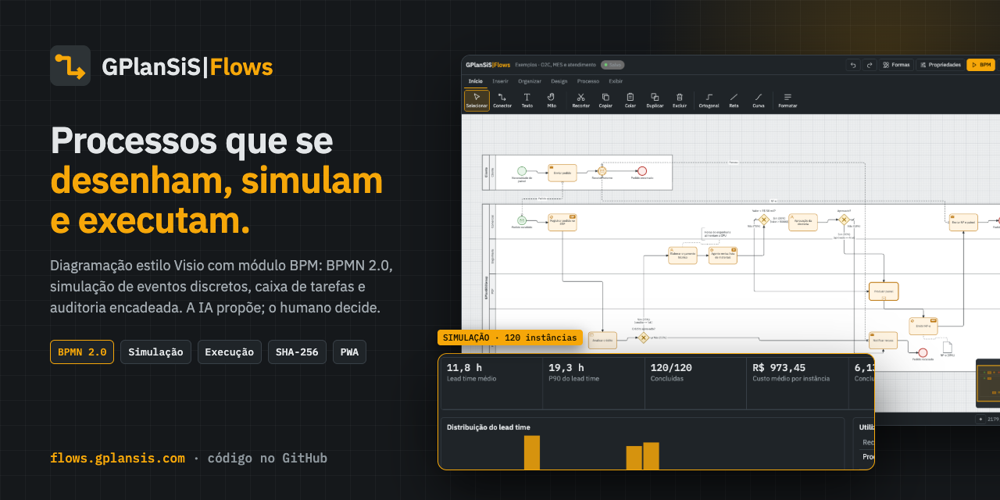
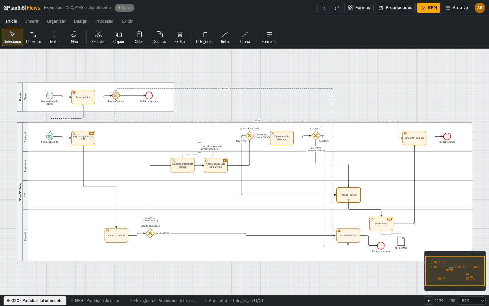
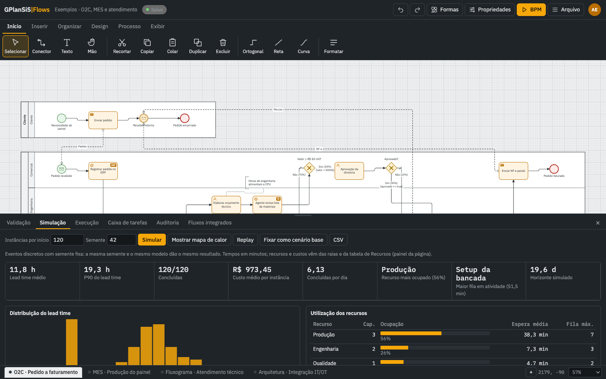
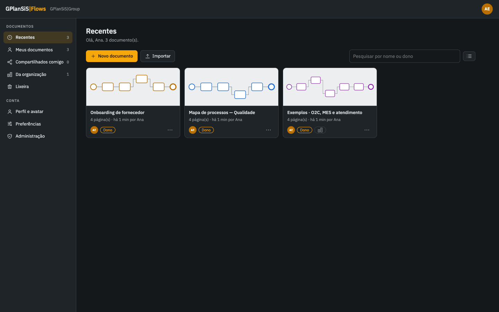
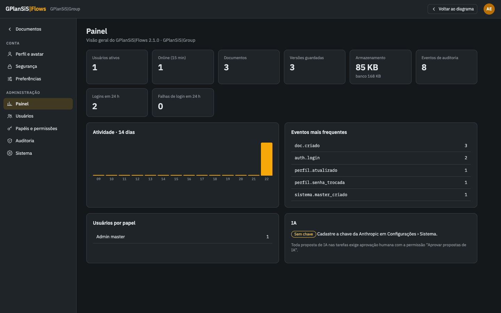
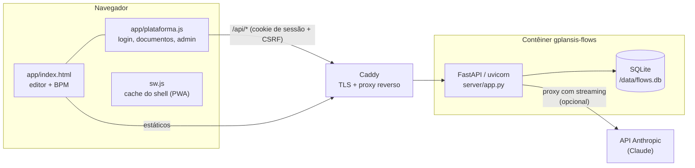

<p align="center">
  <a href="https://flows.gplansis.com"></a>
</p>

<h1 align="center">GPlanSiS|Flows</h1>

<p align="center">
  <strong>Diagramação estilo Visio com módulo BPM: BPMN 2.0, simulação de eventos discretos, execução com caixa de tarefas e auditoria encadeada.</strong><br>
  A IA propõe; o humano decide.
</p>

<p align="center">
  <a href="https://flows.gplansis.com"></a>
  
  
  
  
  
  <a href="CONTRIBUTING.md"></a>
</p>

<p align="center">
  <a href="https://flows.gplansis.com"><b>➜ Abrir o GPlanSiS|Flows em flows.gplansis.com</b></a>
</p>

---

## O que é

O **GPlanSiS|Flows** é um editor de diagramas no navegador, no estilo do Visio, com um módulo de **gestão de processos (BPM)** completo: você desenha o processo em BPMN 2.0, valida a estrutura, simula com eventos discretos para ver gargalos e custos, publica uma versão assinada por hash e executa instâncias com caixa de tarefas — tudo com trilha de auditoria encadeada por SHA-256.

É uma plataforma **multiusuário**: login, papéis e permissões granulares, documentos guardados no servidor com histórico de versões, compartilhamento e presença em tempo real. Roda como um único contêiner (FastAPI + SQLite) e também se instala como aplicativo (PWA) no computador e no celular.

## Funcionalidades

### Diagramação
- **7 grupos de formas**: BPMN 2.0, Integrações, Fluxograma, Básico, TI, Industrial e Organograma.
- **AutoConexão** (setas ao passar o mouse criam a próxima forma já ligada), conectores ortogonais com desvio de formas, retos ou curvos.
- **Pools e raias**, várias páginas por documento, temas, layout automático, minimapa, grade e guias.
- Faixa de opções (Início, Inserir, Organizar, Design, Processo, Exibir) e atalhos de teclado (`V`, `C`, `T`, `H`, `F`, `Ctrl+Z/Y`, `Ctrl+C/V/D`, `Ctrl+G`).

### BPM
- **Validação estrutural**: início/fim, alcançabilidade, gateways (probabilidades, condições, pareamento paralelo), fluxos entre pools, chamadas entre páginas, conectores soltos.
- **Simulação de eventos discretos determinística** (semente fixa): lead time médio e P90, custo por instância, utilização e filas dos recursos, **mapa de calor**, replay, cenário base e exportação CSV.
- **Execução**: motor com instâncias, **caixa de tarefas** e **portão humano para IA** — toda proposta de IA exige aprovação.
- **Governança**: enviar para revisão e publicar versões com hash SHA-256 do modelo; auditoria encadeada com verificação.
- **Integração entre processos**: atividades de chamada entre páginas e mapa de fluxos integrados.

### Importação e exportação
- **BPMN 2.0 com DI** (ida e volta), **SVG**, **PNG**, **JSON**, **CSV** e **DXF** para o GPlanSiS|Drawings.

### Plataforma multiusuário
- Login com sessão segura: senhas com **scrypt**, cookie HttpOnly + Secure + SameSite=Strict, bloqueio após tentativas erradas, proteção CSRF por cabeçalho e origem, troca obrigatória de senha provisória.
- **6 papéis** (Admin master, Administrador, Gestor de processos, Editor, Operador, Leitor) e **16 permissões granulares**, personalizáveis por pessoa e conferidas no servidor a cada gravação.
- **Documentos no servidor**: gravação automática, controle de versão otimista com resolução de conflito, presença em tempo real, histórico (pontos automáticos, versões nomeadas e de publicação) com restauração, compartilhamento por pessoa ou organização, lixeira, duplicar, importar. Alterações que não chegaram ao servidor ficam no navegador para recuperação.
- **Configurações**: perfil com avatar (recorte e zoom), segurança (senha, sessões abertas), preferências; **Administração** com painel de indicadores, usuários, matriz de papéis, auditoria (verificação e CSV) e sistema.

### IA (opcional)
- Proxy no servidor para o **Claude** (Anthropic), com streaming. A chave é cadastrada no painel de administração ou por variável de ambiente e **nunca chega ao navegador**.

### Aplicativo (PWA)
- Instalável no Chrome/Edge, Android e iPhone/iPad. Service worker guarda só o shell estático — nada de `/api/*` nem dado de usuário fica em cache. Interface adaptada ao toque (gavetas, gestos de pan e zoom).

## Telas

| Editor BPMN | Simulação de eventos discretos |
|---|---|
|  |  |
| **Central de documentos** | **Painel de administração** |
|  |  |

> Capturas feitas numa instância local com dados fictícios e os documentos de [`exemplos/`](exemplos).

## Arquitetura



- **Um processo, um banco**: uvicorn com 1 worker (a presença fica em memória e a escrita no SQLite é serializada).
- O servidor serve a API e os arquivos de `app/`, aplica CSP e cabeçalhos de segurança e troca `__BUILD__` do `sw.js` por `2.1.0-<hash dos arquivos>` a cada publicação.
- Contêiner sem root, sistema de arquivos somente leitura, `no-new-privileges`, limite de memória e porta só em `127.0.0.1`.

## Stack

| Camada | Tecnologia |
|---|---|
| Frontend | HTML, CSS e JavaScript sem build (SVG para o desenho), fontes IBM Plex locais, PWA |
| Backend | Python 3.12, FastAPI, uvicorn |
| Banco | SQLite (WAL) |
| IA | SDK `anthropic` (Claude) |
| Implantação | Docker / Docker Compose, Caddy |

## Como rodar localmente

Requisitos: Python 3.12+ (testado também com 3.14).

```bash
git clone https://github.com/SSBianchiplan/flows.git
cd flows
python3 -m venv .venv
.venv/bin/pip install -r server/requirements.txt

FLOWS_DATA=./dados \
FLOWS_SECURE_COOKIE=0 \
FLOWS_MASTER_EMAIL=admin@exemplo.com \
FLOWS_MASTER_PASSWORD='SenhaProvisoria123' \
.venv/bin/uvicorn app:app --app-dir server --port 8899
```

Abra <http://localhost:8899>, entre com o e-mail e a senha acima e defina a nova senha (troca obrigatória no primeiro acesso). Para ter conteúdo, use **Importar** e escolha `exemplos/exemplos.flows.json` ou um dos `.bpmn`.

- `FLOWS_SECURE_COOKIE=0` só serve para `http://localhost`; em produção mantenha `1` (padrão).
- Sem `FLOWS_MASTER_PASSWORD`, uma senha provisória é gerada e aparece uma vez no log.
- A IA fica desligada até você definir `ANTHROPIC_API_KEY` ou cadastrar a chave em **Configurações › Sistema**.

### Com Docker

```bash
cp deploy/.env.example deploy/.env      # preencha com seus valores
docker compose -f deploy/docker-compose.yml up -d --build
# app em http://127.0.0.1:8999 (o cookie é Secure: use atrás de HTTPS, ex.: deploy/flows.caddy)
```

## Estrutura de pastas

```
flows/
├── app/                    # frontend estático (servido pelo FastAPI)
│   ├── index.html          # editor de diagramas + módulo BPM
│   ├── plataforma.js/.css  # login, central de documentos, configurações, admin
│   ├── sw.js               # service worker (PWA)
│   ├── manifest.webmanifest, favicon.svg, icon-*.png
│   └── fonts/              # IBM Plex Sans/Mono (SIL OFL 1.1)
├── server/
│   ├── app.py              # API FastAPI + SQLite
│   └── requirements.txt
├── deploy/
│   ├── Dockerfile
│   ├── docker-compose.yml
│   ├── flows.caddy         # bloco do Caddy (TLS + proxy reverso)
│   └── .env.example
├── exemplos/               # documento de exemplo, BPMN, SVG e DXF
├── LEIA-ME.md              # notas de operação
├── CHANGELOG.md
└── SHA256SUMS              # somas dos arquivos do pacote
```

## Variáveis de ambiente

| Variável | Uso | Padrão |
|---|---|---|
| `FLOWS_MASTER_EMAIL` | E-mail do admin master (único, inalterável pela interface) | `contato@gplansis.com` |
| `FLOWS_MASTER_NAME` | Nome exibido do admin master | `Administrador` |
| `FLOWS_MASTER_PASSWORD` | Senha provisória do master, usada só na primeira subida | gerada e exibida no log |
| `FLOWS_DATA` | Pasta do banco SQLite | `/data` |
| `FLOWS_STATIC` | Pasta dos arquivos do frontend | `app/` |
| `FLOWS_SECURE_COOKIE` | `0` desliga o cookie Secure (só para desenvolvimento em HTTP) | `1` |
| `ANTHROPIC_API_KEY` | Chave da API da Anthropic (a chave cadastrada no painel tem precedência) | vazia (IA desligada) |
| `FLOWS_AI_MODEL` | Modelo do Claude | `claude-opus-5-5` |

Modelo em [`deploy/.env.example`](deploy/.env.example). Nunca versione o `deploy/.env`.

## Contribua

O Flows está aberto para quem quer construir uma ferramenta de processos séria, leve e sem dependência de build. **Toda ajuda conta** — de uma correção de texto a um novo grupo de formas.

**Por onde começar (boas primeiras issues):**
- 🧪 **Testes automatizados** da API (`server/app.py`) com `pytest` + `httpx`: login, permissões por papel, conflito de versão, cadeia de auditoria.
- 🧩 **Novas formas** ou grupos (ex.: DMN, value stream, rede elétrica) no editor.
- 🔁 **Interoperabilidade BPMN 2.0**: testar importação de arquivos gerados por outras ferramentas e corrigir o que não abrir bem.
- 🌐 **Internacionalização**: extrair os textos da interface (hoje em pt-BR) para permitir inglês e espanhol.
- ♿ **Acessibilidade**: navegação por teclado no canvas, rótulos ARIA, contraste.
- 📱 **Celular e tablet**: refinar gestos, gavetas e telas pequenas.
- 📚 **Documentação**: tutoriais de modelagem e simulação, exemplos de processos.
- 🛠️ **CI**: workflow do GitHub Actions com lint (ruff) e testes.

Leia o [guia de contribuição](CONTRIBUTING.md), abra uma [issue](../../issues/new/choose) para combinar a ideia e mande seu pull request. Siga o [código de conduta](CODE_OF_CONDUCT.md). Encontrou uma falha de segurança? Veja a [política de segurança](SECURITY.md) — não abra issue pública.

## Licença

**Licença: a definir pela GPlanSiS.** Até a definição, todos os direitos são reservados à GPlanSiS|Group; o código está publicado para consulta e colaboração.

Componentes de terceiros incluídos: fontes **IBM Plex Sans / Mono** sob a [SIL Open Font License 1.1](app/fonts/LICENSE-OFL.txt). Dependências Python: FastAPI (MIT), uvicorn (BSD-3-Clause), anthropic (MIT).

## Créditos

Desenvolvido pela **[GPlanSiS|Group](https://gplansis.com)** · contato: [contato@gplansis.com](mailto:contato@gplansis.com)

<p align="center"><a href="https://flows.gplansis.com"><b>flows.gplansis.com</b></a></p>
